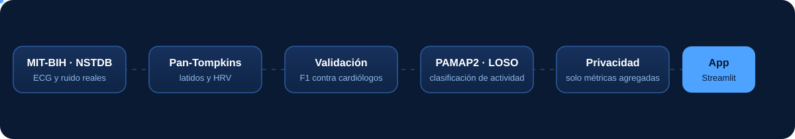

<div align="center">


<br/>

<h3>Desarrolladores</h3>

<table>
  <tr>
    <td align="center" width="50%">
      <a href="https://github.com/invertilo">
        
      </a>
      <br/><br/>
      <b>invertilo</b>
      <br/>
      <a href="https://github.com/invertilo">github.com/invertilo</a>
    </td>
    <td align="center" width="50%">
      <a href="https://github.com/alejondr3">
        
      </a>
      <br/><br/>
      <b>alejondr3</b>
      <br/>
      <a href="https://github.com/alejondr3">github.com/alejondr3</a>
    </td>
  </tr>
</table>

<p>
  
  
  
  
  
</p>

</div>


> [!WARNING]
> **Prototipo para demostración.** No es un dispositivo médico. No está validado para diagnóstico ni para uso en vuelo, y no usa datos de astronautas. Todo el análisis se hace sobre datos abiertos de PhysioNet y UCI.

## Qué hace

<table>
  <tr>
    <td width="50%">
      <h4>ECG (MIT-BIH)</h4>
      Filtro pasa-banda, detección de latidos con <b>Pan-Tompkins</b>, frecuencia cardíaca, variabilidad (RMSSD, SDNN, pNN50) y alertas de irregularidad como cribado.
    </td>
    <td width="50%">
      <h4>Validación contra cardiólogos</h4>
      Comparación con las anotaciones de los 48 registros: sensibilidad, precisión y F1, con tolerancia de 150 ms.
    </td>
  </tr>
  <tr>
    <td width="50%">
      <h4>Robustez al ruido (NSTDB)</h4>
      Rendimiento con ruido real de músculo y movimiento, con y sin <b>abstención</b> por índice de calidad de señal: el sistema prefiere no decir nada antes que alarmar mal.
    </td>
    <td width="50%">
      <h4>Reconocimiento de actividad (PAMAP2)</h4>
      Clasificación de 18 actividades con acelerometría y frecuencia cardíaca, validada <i>leave-one-subject-out</i> sobre 9 sujetos.
    </td>
  </tr>
  <tr>
    <td width="50%">
      <h4>Carga fisiológica (DriveDB)</h4>
      Análisis exploratorio de frecuencia cardíaca, respuesta de la piel y respiración durante la conducción. <i>Sin etiquetas de estrés, así que no es un clasificador de estrés.</i>
    </td>
    <td width="50%">
      <h4>Privacidad por diseño</h4>
      Solo salen métricas agregadas. La señal cruda nunca sale del dispositivo, y hay una verificación que lo impide.
    </td>
  </tr>
</table>

## Resultados reales

<div align="center">
  
</div>

| Medida | Resultado |
|---|---|
| F1 en el registro 100 de MIT-BIH | **1.000** (2273 latidos, 0 falsos positivos, 0 perdidos) |
| F1 promedio en los 48 registros | **0.993** |
| Peor registro (108) | 0.865 |
| F1 con ruido de músculo a 0 dB, sin / con abstención | 0.98 / 0.98 |
| F1 con ruido a −6 dB, sin / con abstención | 0.79 / 0.84 (se acepta el 52 % de las ventanas) |
| Reconocimiento de actividad (PAMAP2, LOSO, 9 sujetos) | **Accuracy 0.801**, F1 macro 0.763. El sujeto 109 tiene solo 12 ventanas, así que su 1.000 no es confiable. |

## Arquitectura

<div align="center">
  
</div>

<br/>

| Módulo | Qué hace |
|---|---|
| `losti/data_loader.py` | Lee MIT-BIH, NSTDB, PAMAP2 y DriveDB |
| `losti/ecg.py` | Filtro y detección de latidos (Pan-Tompkins) |
| `losti/hrv.py` | Métricas de variabilidad y alertas de irregularidad |
| `losti/validation.py` | F1 contra anotaciones y curva de ruido con abstención |
| `losti/wearable.py` | Ventanas y features de PAMAP2 |
| `losti/classifier.py` | Clasificador con validación leave-one-subject-out |
| `losti/drivedb.py` | Perfil fisiológico exploratorio (sin etiquetas) |
| `losti/privacy.py` | Payload agregado y verificación de que no sale señal cruda |

## Instalación

Requiere **Python 3.12**.

```bash
python3.12 -m venv .venv
.venv/bin/pip install -r requirements.txt
.venv/bin/python scripts/download_data.py   # MIT-BIH, NSTDB, DriveDB y PAMAP2
```

## Ejecutar la app

```bash
.venv/bin/streamlit run app/streamlit_app.py
```

Se abre en `http://localhost:8501`. Cada cambio de sección muestra un splash animado.

## Tests

```bash
.venv/bin/pytest
```

Los tests usan datos reales. Los que dependen de un dataset no descargado se saltan con un mensaje claro.

## Estructura

```
LosTiraVida/
├── app/            interfaz Streamlit (tema, splash, secciones)
├── src/losti/      librería de análisis
├── scripts/        descarga de datasets
├── tests/          tests sobre datos reales
├── docs/           contrato de módulos
└── assets/         logo, banner y animaciones
```

## Fuentes de datos

- **MIT-BIH Arrhythmia Database**: [physionet.org/content/mitdb](https://physionet.org/content/mitdb/1.0.0/), Open Data Commons Attribution (ODC-By).
- **MIT-BIH Noise Stress Test Database**: [physionet.org/content/nstdb](https://physionet.org/content/nstdb/1.0.0/).
- **PAMAP2 Physical Activity Monitoring**: [UCI, id 231](https://archive.ics.uci.edu/dataset/231/pamap2+physical+activity+monitoring), CC BY 4.0. Cita: Reiss & Stricker, ISWC 2012.
- **Stress Recognition in Automobile Drivers (DriveDB)**: [physionet.org/content/drivedb](https://physionet.org/content/drivedb/), ODC-By v1.0. Cita: Healey & Picard, IEEE T-ITS 6(2), 2005.

## Límites

- No es un dispositivo médico ni un sistema de diagnóstico.
- La regla de irregularidad es un cribado, no una clasificación clínica.
- PAMAP2 clasifica actividades, no estados emocionales ni de salud.
- DriveDB no tiene etiquetas de estrés en la fuente oficial, así que el análisis es exploratorio.
- Los registros de MIT-BIH son de pacientes de un hospital entre 1975 y 1979; no representan a una tripulación.
- Para uso real haría falta un acuerdo de datos con NASA y una validación regulatoria.


<div align="center">

Hecho con datos abiertos, para que los sistemas de monitoreo sean verificables.

</div>
