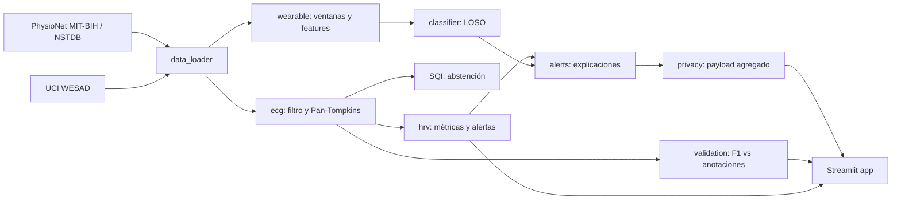

<div align="center">


<br/>

### Desarrolladores

<table>
  <tr>
    <td align="center" width="50%">
      <a href="https://github.com/invertilo">
        
      </a>
      <br/><br/>
      <b>invertilo</b>
      <br/>
      <a href="https://github.com/invertilo">github.com/invertilo</a>
    </td>
    <td align="center" width="50%">
      <a href="https://github.com/alejondr3">
        
      </a>
      <br/><br/>
      <b>alejondr3</b>
      <br/>
      <a href="https://github.com/alejondr3">github.com/alejondr3</a>
    </td>
  </tr>
</table>

<p>
  
  
  
  
</p>

</div>

---

> [!WARNING]
> **Prototipo para demostración.** No es un dispositivo médico. No está validado para diagnóstico ni para uso en vuelo, y no usa datos de astronautas. Todo el análisis se hace sobre datos abiertos de PhysioNet y UCI.

## Qué hace

<table>
  <tr>
    <td width="50%">
      <h4>ECG en tiempo real (MIT-BIH)</h4>
      Filtro pasa-banda, detección de latidos con <b>Pan-Tompkins</b>, frecuencia cardíaca, variabilidad (RMSSD, SDNN, pNN50) y alertas de irregularidad como cribado.
    </td>
    <td width="50%">
      <h4>Validación contra cardiólogos</h4>
      Comparación con las anotaciones de los 48 registros: sensibilidad, precisión y F1, con tolerancia de 150 ms.
    </td>
  </tr>
  <tr>
    <td width="50%">
      <h4>Robustez al ruido (NSTDB)</h4>
      Rendimiento con ruido real de músculo y movimiento, con y sin <b>abstención</b> por índice de calidad de señal: el sistema prefiere no decir nada antes que alarmar mal.
    </td>
    <td width="50%">
      <h4>Estado a partir de wearable (WESAD)</h4>
      Clasificación de reposo, estrés y diversión con validación <i>leave-one-subject-out</i>, y detección de desacuerdo entre sensores de pecho y muñeca.
    </td>
  </tr>
  <tr>
    <td width="50%">
      <h4>Privacidad por diseño</h4>
      Solo salen métricas agregadas. La señal cruda nunca sale del dispositivo, y hay una verificación que lo impide.
    </td>
    <td width="50%">
      <h4>Explicaciones legibles</h4>
      Cada alerta dice qué pasó y contra qué línea base: <i>"Heart rate 112 bpm, 51% above your baseline (74 bpm)"</i>.
    </td>
  </tr>
</table>

## Resultados reales

| Medida | Resultado |
|---|---|
| F1 en el registro 100 de MIT-BIH | **1.000** (2273 latidos, 0 falsos positivos, 0 perdidos) |
| F1 promedio en los 48 registros | **0.993** |
| Peor registro (108) | 0.865 |
| F1 con ruido de músculo a 0 dB, sin / con abstención | 0.98 / 0.98 |
| F1 con ruido a −6 dB, sin / con abstención | 0.79 / 0.84 (se acepta el 52 % de las ventanas) |
| Clasificación de estado (WESAD, LOSO) | *pendiente: falta el dataset* |

## Arquitectura



## Instalación

Requiere **Python 3.12**.

```bash
python3.12 -m venv .venv
.venv/bin/pip install -r requirements.txt
.venv/bin/python scripts/download_data.py   # MIT-BIH y NSTDB; WESAD si está disponible
```

## Ejecutar la app

```bash
.venv/bin/streamlit run app/streamlit_app.py
```

Se abre en `http://localhost:8501`. Cada cambio de sección muestra un splash animado.

## Tests

```bash
.venv/bin/pytest
```

Los tests usan datos reales. Los que dependen de WESAD se saltan si el dataset no está descargado.

## Estructura

```
LosTiraVida/
├── app/            interfaz Streamlit (tema, splash, secciones)
├── src/losti/      librería de análisis
├── scripts/        descarga de datasets
├── tests/          tests sobre datos reales
├── docs/           contrato de módulos
└── assets/         logo y banner
```

## Fuentes de datos

- **MIT-BIH Arrhythmia Database**: [physionet.org/content/mitdb](https://physionet.org/content/mitdb/1.0.0/)
- **MIT-BIH Noise Stress Test Database**: [physionet.org/content/nstdb](https://physionet.org/content/nstdb/1.0.0/)
- **WESAD**: [UCI Machine Learning Repository](https://archive.ics.uci.edu/dataset/465)

## Límites

- No es un dispositivo médico ni un sistema de diagnóstico.
- La regla de irregularidad es un cribado, no una clasificación clínica.
- La validación usa registros de pacientes de un hospital de 1975–1979; no representa una población de tripulación.
- Para uso real haría falta un acuerdo de datos con NASA y una validación regulatoria.

<div align="center">

<br/>

Hecho con datos abiertos, para que los sistemas de monitoreo sean verificables.

</div>
