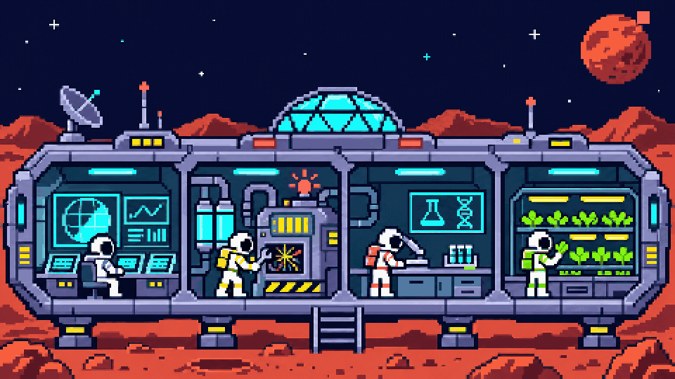
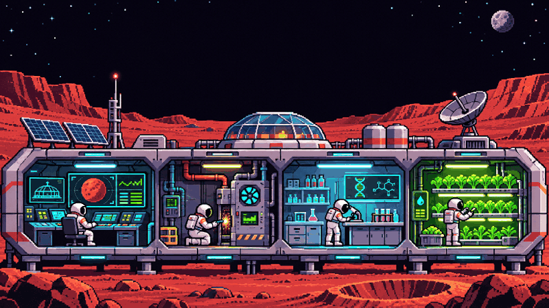

<div align="center">



# PUESTO MARTE

### Un simulador de supervivencia espacial en 8-BIT

Administra energía, recursos y tripulación durante una misión de 365 días. Cada decisión cambia el destino del puesto.

[](https://react.dev/)
[](https://www.typescriptlang.org/)
[](https://vite.dev/)
[](#calidad)
[](https://los-tira-vida.vercel.app)

[Jugar ahora](https://los-tira-vida.vercel.app) · [Cómo funciona](#cómo-se-juega) · [Instalación](#desarrollo-local) · [Equipo](#equipo)

</div>

---

## La misión

Puesto Marte es un juego de estrategia y supervivencia inspirado en sistemas reales de soporte vital. Debes mantener con vida a cuatro tripulantes durante un año terrestre completo, equilibrando oxígeno, agua, alimentos, batería, radiación, moral y estrés.

No es un tablero estático: el hábitat está vivo. Los personajes 8-BIT patrullan, trabajan, descansan y reparan averías según el estado real de la simulación.

<div align="center">



</div>

## Qué encontrarás

| Sistema | Qué sucede en la misión |
| --- | --- |
| **Tripulación visible** | Cuatro especialistas animados trabajan en control, soporte vital, laboratorio e hidroponía. |
| **Nave explorable** | Recorre el hábitat y su ala de ingeniería en una cubierta lateral larga con luces, cielo marciano y alertas ligadas al estado de la misión. |
| **Reparaciones jugables** | Seis estaciones ofrecen minijuegos cortos de energía, soporte vital, cultivos, comunicaciones, blindaje y agua. Las alertas llevan directamente al sistema afectado; asignar especialistas acelera más la reparación y cada tarea modifica recursos o adelanta una avería real. |
| **Recursos conectados** | Oxígeno, agua, alimentos, batería y radiación evolucionan cada hora. |
| **Energía limitada** | Distribuyes el presupuesto entre soporte vital, escudo e hidroponía. Nunca alcanza para todo. |
| **Ciclo día/noche** | La producción solar cambia y obliga a sobrevivir con la batería durante la noche. |
| **Emergencias** | Tormentas, fugas, fallas técnicas, radiación y enfermedades alteran la simulación. |
| **Diagnóstico comprensible** | Cada alerta explica el riesgo y cuánto dura el efecto; el visor de causa y efecto muestra cómo el presupuesto energético llega al oxígeno, el agua, la cosecha y el blindaje. |
| **Reparaciones con costo** | Asignar personal acelera las reparaciones, pero eleva su estrés. La ingeniería tiene ventaja. |
| **Dificultad real** | Los niveles cambian reservas, radiación, eventos y batería inicial. |
| **Interfaz en español** | Paneles, alertas, tutorial y explicaciones contextuales completamente localizados. |

## Cómo se juega

1. Elige una misión lunar o marciana y selecciona la dificultad.
2. Inicia el reloj y observa el comportamiento del hábitat.
3. Reparte la energía sin superar el 100 % del presupuesto.
4. Reacciona a las alertas y asigna al tripulante adecuado para reparar.
5. Controla moral, estrés, radiación y reservas hasta completar 365 días terrestres.

### Recorre la nave y resuelve averías

Abre **Operaciones** para caminar por el hábitat y el ala de ingeniería. Usa `A` / `D` o `←` / `→`; en móvil, toca las flechas o desliza el pasillo. Cuando una estación esté al alcance, pulsa `E` o selecciónala. Cada una tiene un minijuego de pocos pasos y puede usarse una vez por estación cada sol.

La consola parpadea en rojo cuando un sistema necesita atención; cada alerta explica el riesgo y tiene un botón para abrir la estación afectada y su tarea. Por la noche se atenúan las luces y titila el cielo del ventanal. Si una persona está cansada, herida o en estado crítico, su traje también lo muestra. Antes de empezar cada tarea verás su posible beneficio; puedes asignar a un tripulante y su especialidad acelera hasta cuatro horas extra una reparación, con un costo de estrés. Al terminar, un mensaje explica exactamente qué cambió. El resultado también queda en la bitácora y en la partida guardada.

La velocidad `1X` representa una hora simulada por segundo. `2X` y `4X` permiten avanzar con rapidez sin perder el control de las emergencias.

### Señales importantes

- **Verde:** el sistema opera normalmente.
- **Amarillo:** requiere atención o está siendo reparado.
- **Rojo:** existe una incidencia activa.
- **Noche:** la base depende de la batería; una mala distribución energética puede terminar la misión.

## Diseño 8-BIT

La interfaz combina pixel art, tipografía de terminal, scanlines, alto contraste y animación funcional. El movimiento no es decorativo: comunica quién está trabajando, quién descansa y dónde ocurre una avería.

El diseño se adapta a escritorio y celular. En pantallas pequeñas, el hábitat se convierte en una cuadrícula 2×2, los controles ocupan dos filas compactas y los paneles evitan desplazamiento horizontal.

## Tecnología

```text
React 19 + TypeScript
├── Motor de simulación por horas
├── Sistema probabilístico de eventos
├── Física y constantes de misión
├── Componentes de interfaz accesibles
├── Animaciones Motion + CSS
└── Vite 8 + Tailwind CSS 4
```

La simulación y la presentación están separadas: `src/engine` mantiene las reglas del juego, mientras `src/components` representa el estado mediante paneles, alertas y personajes. En Gestión, el visor **Causa y efecto** relaciona la asignación de energía con los sistemas y muestra los eventos que están cambiando su rendimiento.

Las reparaciones manuales usan las mismas reglas y el mismo estado guardado que la simulación por horas; la interfaz no aplica recompensas ficticias. La cubierta funciona como un recorrido lateral que sigue al personaje, también al cambiar el tamaño de pantalla.

## Desarrollo local

Necesitas Node.js 20 o superior y npm.

```bash
git clone https://github.com/invertilo/LosTiraVida.git
cd LosTiraVida
npm install
npm run dev
```

Abre [http://localhost:5173](http://localhost:5173).

### Comandos

| Comando | Uso |
| --- | --- |
| `npm run dev` | Inicia el servidor de desarrollo. |
| `npm run build` | Genera la versión optimizada en `dist/`. |
| `npm run preview` | Previsualiza la compilación de producción. |
| `npm run test` | Ejecuta las pruebas del motor y balance. |
| `npm run type-check` | Verifica TypeScript sin generar archivos. |
| `npm run lint` | Revisa la calidad del código. |

## Calidad

El proyecto incluye pruebas de constantes NASA, consumo de recursos, eventos, dificultad, estabilidad a largo plazo y balance de misiones completas.

```bash
npm run type-check
npm run lint
npm run test
npm run build
```

Estado actual: **123 pruebas correctas**. Las pruebas incluyen valores NASA con las hipótesis de balance del hábitat documentadas por separado.

## Despliegue

El proyecto está preparado para Vercel mediante `vercel.json`:

```bash
npm run build
npx vercel --prod
```

Las rutas se redirigen a `index.html`, los recursos compilados reciben caché inmutable y se aplican cabeceras de seguridad.

## Estructura

```text
LosTiraVida/
├── docs/assets/          # Arte y animaciones del README
├── public/               # Fuentes, íconos y recursos estáticos
├── src/
│   ├── components/       # Paneles, controles y personajes 8-BIT
│   ├── engine/           # Simulación, eventos, física y datos NASA
│   ├── hooks/            # Estado y reloj de la simulación
│   ├── lib/              # Utilidades de misión, movimiento y puntuación
│   ├── styles/           # Sistema visual 8-BIT y responsive
│   └── tests/            # Pruebas de estabilidad y balance
├── vercel.json
└── vite.config.js
```

## Equipo

<div align="center">

<table>
  <tr>
    <td align="center" width="50%">
      <a href="https://github.com/invertilo">
        
        <br /><br />
        <strong>invertilo</strong>
      </a>
      <br />
      Desarrollo y dirección del proyecto
    </td>
    <td align="center" width="50%">
      <a href="https://github.com/alejondr3">
        
        <br /><br />
        <strong>alejondr3</strong>
      </a>
      <br />
      Desarrollo y colaboración
    </td>
  </tr>
</table>

Hecho con curiosidad espacial, decisiones difíciles y muchos píxeles.

</div>

## Créditos y datos

El juego utiliza valores inspirados en documentación pública de NASA BVAD, ISS, MSL-RAD y Chang'E-4. Las fuentes y los ajustes de jugabilidad están documentados en [`src/engine/NASAData.ts`](src/engine/NASAData.ts) y [`GAMEPLAY.md`](GAMEPLAY.md).

El arte principal del README fue creado específicamente para este proyecto y no representa una misión oficial de NASA.

---

<div align="center">

**¿Puedes mantener el puesto con vida durante 365 días?**

[INICIAR MISIÓN](https://los-tira-vida.vercel.app)

</div>
